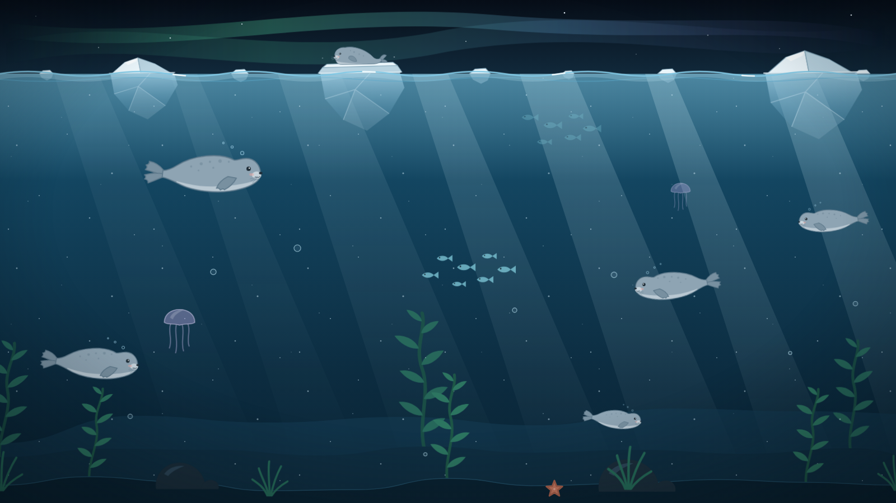
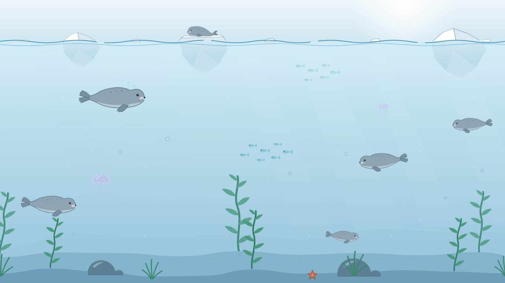

# Seal Theme for Claude Code

English | [繁體中文](README.zh-TW.md)

A Claude Code theme mod in icy-mist and deep-sea colors. Behind your conversation is a living polar sea: five seals swim beneath the surface (one is chasing a school of fish), another lounges on an ice floe, and there are icebergs, jellyfish, kelp, starfish and an aurora.

| Dark mode (night) | Light mode (day) |
| --- | --- |
|  |  |

The previews show the background alone. In use, your conversation sits on top, and the seals, fish and waves move.

## Features

- Dark mode is a night sea with an aurora and stars; light mode is a daytime ice field.
- The conversation area gets only a light, unblurred veil, so you can still see seals swimming behind the text.
- Messages are styled by speaker: yours are solid bubbles, while Claude's replies use the same transparent outlined frame as the "next step" box (desktop only).
- The background stops moving when your system's "reduce motion" setting is on.

## Install

Requires the Claude Code CLI, version 2.1.323 or later (`claude --version` shows yours). In a terminal, run:

```bash
claude plugin marketplace add hsuhe/claude-seal-theme
claude plugin install seal-theme@claude-seal-theme
```

It installs at user scope by default, so it applies to every session, including the Code tab of the Claude desktop app. Start a new conversation to see the theme. The animated background shows in the desktop and mobile apps; the reply frame style is desktop only.

## Update

Auto-update is off by default for marketplaces you add yourself. To get a new version, run:

```bash
claude plugin marketplace update claude-seal-theme
claude plugin update seal-theme@claude-seal-theme
```

The update applies after you restart Claude Code.

## Uninstall

```bash
claude plugin uninstall seal-theme@claude-seal-theme
claude plugin marketplace remove claude-seal-theme
```

## What this plugin runs

This plugin is a mod: `hooks/register.tsx` is a hooks module that Claude Code loads and runs with your permissions, as it does every mod. This is everything it does:

- When a session starts, it applies the seal color theme and the animated background (`$.theme.set`). If the app can't draw them, it shows the reason in the status line (`$.ui.status`). If the color check finds a problem that would stop the desktop app from painting the theme, it shows that line as a toast (`$.ui.toast`).
- When the desktop or mobile app draws the background, it supplies the polar sea scene, an SVG written inline in `register.tsx`.
- In the desktop app, it wraps each of Claude's replies in an outlined frame.

The two drawing hooks use `$.ui.resolve` only to get the app's own `Svg` and `Box` components. `hooks/make-colors.js` turns a few base colors into the full light and dark color sets, once, when the module loads.

The plugin makes no network requests, doesn't read or write files, doesn't start processes, and doesn't collect, store or send any data. It loads no external images or fonts: the whole background comes from the SVG inside `register.tsx`.

## Known limitations

- The reply frame's border color is fixed and tuned for dark mode.

## License

MIT, see [LICENSE](LICENSE). `hooks/make-colors.js` and `hooks/make-colors.d.ts` are copied unchanged from Claude Code's plugin-authoring skill and are not covered by this license.
