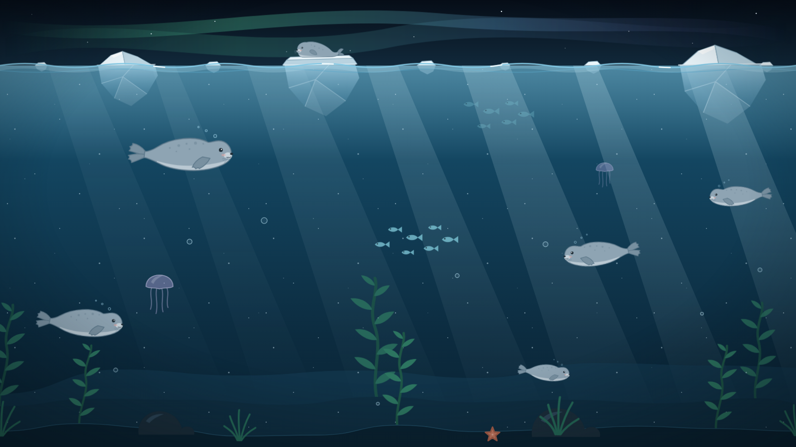
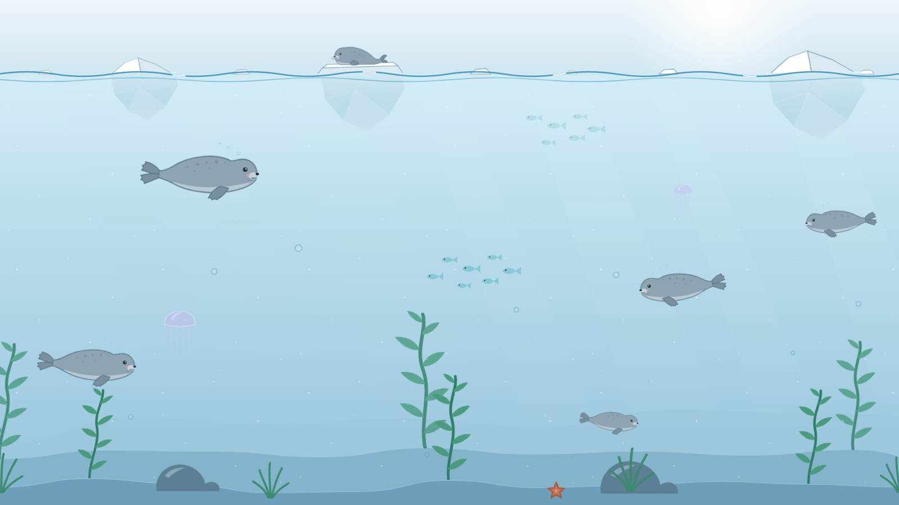

# 海豹主題 Seal Theme

[English](README.md) | 繁體中文

Claude Code 的主題 mod：冰霧與深海配色。對話背後是一片會動的冰海，五隻海豹在水面下游來游去（其中一隻在追魚群），浮冰上還趴著一隻，另外有冰山、水母、海藻、海星和極光。

| 深色模式（夜晚） | 淺色模式（白天） |
| --- | --- |
|  |  |

預覽圖只有背景本身；實際使用時對話會疊在上面，海豹、魚群和海浪都會動。

## 特色

- 深色模式是夜晚的冰海（極光、星星），淺色模式是白天的冰原。
- 對話區只加一層淡淡的遮罩、不做模糊，海豹游過文字後面也看得到。
- 對話外觀按說話者統一：你的訊息是實心泡泡，Claude 的回覆跟「下一步」框一樣是透明淡框（僅桌面版）。
- 系統開啟「減少動態效果」時，背景動畫會停止。

## 安裝

需要 Claude Code 命令列版。在終端機執行：

```bash
claude plugin marketplace add hsuhe/claude-seal-theme
claude plugin install seal-theme@claude-seal-theme
```

預設裝在 user 範圍，之後每個 session 都會套用，Claude 桌面版的 Code 分頁也會載入。開新對話就會看到主題。動態背景在桌面版與手機版顯示，回覆框樣式只在桌面版。

## 已知限制

- 回覆框的框線顏色是固定的，以深色模式為準。

## 授權

MIT，見 [LICENSE](LICENSE)。`hooks/make-colors.js` 與 `hooks/make-colors.d.ts` 是從 Claude Code 的 plugin-authoring skill 原樣複製的工具檔，不在本授權範圍內。
